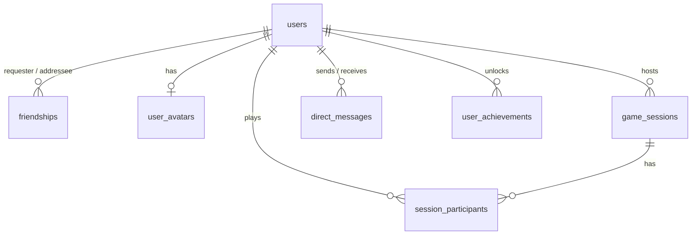

*This project has been created as part of the 42 curriculum by gzovkic, dreule, mimalek, ykhattab*

# LingoDash

## Description

**LingoDash** is a real-time multiplayer game for learning languages by speaking them. Two players
join a lobby, pick a language (English, German, Polish or Turkish) and get **different halves of
the same puzzle**:

- **Mission Control** sees written clues like *"The lamp is left of the sofa"* – in the language
  being learned.
- **On Site** sees the living room and can move the furniture, but has no clues.

The only way to win is to **talk**: Mission Control describes the target room out loud over the
built-in voice chat, On Site rearranges it, and Mission Control checks the result. Every round
earns XP, levels and achievements, and players can add friends, chat with them and compare
themselves on a leaderboard.

### Key features

- Live 2-player game made in **Godot 4**, exported to WebAssembly and embedded in the website
- Lobbies with join codes, roles, ready-up and countdown
- **Peer-to-peer voice chat** (WebRTC) between the two players of a lobby
- Accounts with email + password, profile editing, profile pictures, online status
- Friends, **live text chat** between friends, public profiles
- Match history, XP, **levels, 13 achievements and a leaderboard**
- Whole interface in **4 languages** (en / de / pl / tr), accessible (WCAG AA contrast, keyboard,
  screen-reader labels)
- One HTTPS entry point (nginx), reachable from other computers on the same network

## Instructions

### Prerequisites

| Tool | Version | Notes |
|---|---|---|
| Docker + Docker Compose | Docker 24+ / Compose v2 | Docker Desktop must be running |
| make, openssl | any | preinstalled on macOS / most Linux |
| Google Chrome | latest stable | the supported browser |
| Godot | 4.x | **only** to change the game; the exported build is already in `frontend/public/` |
| Go | 1.26 | only to run the backend tests outside Docker |

### Run

```sh
git clone <this repository>
cd ft_transcendence
cp .env.example .env      # then set JWT_SECRET (long random string) and POSTGRES_PASSWORD
make up                   # builds, starts, applies migrations, prints the URLs
```

Open **https://localhost:8443** and accept the self-signed certificate once.
`make up` also prints the address for a second computer on the same network
(`https://<host-ip>:8443`), so two people can play on two machines.
A step-by-step guide for two-PC testing and troubleshooting is in [SETUP.md](SETUP.md).

### Configuration (`.env`)

| Variable | Purpose |
|---|---|
| `JWT_SECRET` | **required** – signs the login tokens |
| `POSTGRES_PASSWORD` | **required** – database password |
| `POSTGRES_USER` / `POSTGRES_DB` | database user and name (default `transcendence`) |
| `HTTPS_PORT` / `HTTP_PORT` | nginx ports (8443 / 8000; above 1024 for rootless Docker) |
| `VITE_API_URL` | leave **empty** – the site talks to the address it was opened from |
| `VOICE_REQUIRED` | `false` lets you ready up without a microphone (testing from the Godot editor) |
| `VITE_STUN_URLS` | optional STUN servers for voice chat across different networks |

### Useful commands

```sh
make up        # build and start everything (+ migrations)
make down      # stop everything
make restart   # after changing .env
make logs      # follow all logs
make url       # print the addresses to open
make test      # backend tests without the database (go test ./...)
make test-db   # all backend tests, including the database tests
make health    # check the backend and the database through HTTPS
make migrate   # re-apply the SQL migrations (they are idempotent)
```

`make test-db` runs all backend tests **including the database tests** against the running
Postgres (after `make up`). Postgres is not published to the host, so the tests run in a Go
container on the project's internal Docker network.

---

## Team Information

| Member | Role(s) | Responsibilities |
|---|---|---|
| **gzovkic** | Product Owner, Developer | Godot game, game networking, voice chat, HTTPS/LAN hosting, match history & XP, chat, levels & achievements |
| **dreule** (Daniel) | Technical Lead, Developer | Backend core: Echo API, authentication, lobbies & matchmaking, role resolution, Docker/DB setup, WebRTC signalling |
| **mimalek** (Miguel) | Project Manager, Developer | Frontend: landing page, dashboard, design system, accessibility, interface translations, profiles, avatars, friends UI, legal pages |
| **yousefkh2** (Yousef) | Developer | Project foundation (Docker setup, CI), first version of the realtime WebSocket hub, server-side round state (object positions, objectives, round timer) |

## Project Management

- **Organisation:** we did not use an issue board. Tasks were discussed, split and agreed on
  directly in our team chat; each member took ownership of their area (see *Team Information*)
  and reported progress there.
- **Tools:** GitHub (repository `ft_transcendence`), feature branches + pull requests
  (`feature/*`, `frontend/*`, `godot/*`), GitHub Actions CI.
- **Communication:** a WhatsApp group chat for daily coordination, decisions and code-review
  requests.
- **Quality:** every pull request runs CI: Go tests, a production build of the frontend
  (`vue-tsc` type check + `vite build`) and `docker compose config` validation
  (`.github/workflows/ci.yml`).

## Technical Stack

| Layer | Technology | Why |
|---|---|---|
| Frontend | **Vue 3** + Vue Router, TypeScript, Vite | component framework with a small API; TypeScript catches i18n key and API type mistakes at build time |
| Styling | Own design system (CSS custom properties + 12 `Base*` components) | consistent colours/typography without a heavy UI kit |
| Game | **Godot 4** (GDScript), Web export (WASM) | a real game engine for the interactive room; runs in an `<iframe>` inside the site |
| Backend | **Go** + **Echo** | fast, simple concurrency (goroutines) for many WebSocket connections |
| Realtime | WebSockets (`coder/websocket`) | lobby updates, game messages, chat delivery, voice signalling |
| Voice | **WebRTC** (browser to browser) | audio never goes through our server – low latency, no media server needed |
| Database | **PostgreSQL 17** with `pgx` | relational data (users, friendships, rounds) with real constraints and transactions |
| Auth | bcrypt + JWT (HS256, 24 h) | standard, salted password hashing; stateless sessions |
| Entry point | **nginx** (TLS) | one HTTPS address for site, API and WebSockets – browsers only allow the microphone on HTTPS |
| Runtime | Docker Compose, Makefile | one command to start everything |

---

## Database Schema

All tables are created by the SQL files in `backend/sql/migrations/` (applied in order by
`make migrate`; every file is safe to run again).



| Table | Key fields | What it stores |
|---|---|---|
| `users` | `id UUID PK`, `username VARCHAR(50) UNIQUE`, `email VARCHAR(255) UNIQUE`, `password_hash`, `xp INT`, `learning_lang VARCHAR(5)`, `last_seen_at TIMESTAMPTZ` | accounts, total XP, online status (last heartbeat) |
| `friendships` | `requester_id`, `addressee_id` → users, `status` (`pending` / `accepted`) | friend requests; a unique index on the *unordered* pair allows only one row per two users |
| `user_avatars` | `user_id PK` → users, `image BYTEA`, `content_type` | profile pictures (re-encoded by the backend, no metadata) |
| `game_sessions` | `id`, `code VARCHAR(8) UNIQUE`, `host_user_id`, `status` (`waiting` → `active` → `completed`), `lang`, `started_at`, `ended_at`, `end_reason` (`solved` / `time_up` / `out_of_checks`), `failed_checks` | one lobby = one round |
| `session_participants` | `session_id`, `user_id` (unique pair), `role` (`mission_control` / `on_site`), `is_winner`, `score_delta` (XP earned) | who played which round in which role |
| `direct_messages` | `sender_id`, `recipient_id` → users, `body TEXT` (1–1000 chars, CHECK), `created_at`, `read_at` | friend chat; indexed per conversation |
| `user_achievements` | `(user_id, achievement_id) PK`, `unlocked_at`, `seen_at` | unlocked achievements; `seen_at` drives the "unlocked!" pop-up |
| `flashcards` | `user_id`, `session_id`, phrases | prepared for a future review feature, not used yet |

Deleting an account cascades to friendships, messages, avatars, achievements and participations;
completed rounds stay in the other player's history.

---

## How it works

### Request flow

```
Browser ──HTTPS/WSS──► nginx :8443 ──► /api, /ws/*  ──► Go backend :8080 ──► PostgreSQL
                                  └──► everything else ► Vue site (+ Godot game in an iframe)
Browser ◄────────────── WebRTC audio (direct, peer-to-peer) ──────────────► Browser
```

The Godot game runs inside the website. It gets the login token from the page through
`postMessage` (origin-checked), so players never log in twice, and uses the same REST API and
WebSockets as the site.

### Lobby → round

1. A player creates a lobby (`POST /api/lobbies`) and gets a code from an unambiguous alphabet
   (no `0/O`, `1/I`). The second player joins with it. A lobby holds exactly 2 players.
2. Both connect to `/ws/lobby`, pick a role (each role only once – enforced in the DB) and press
   **Ready**. With `VOICE_REQUIRED`, ready-up is blocked until the player's microphone is connected.
3. When both are ready the server counts down 5…0 (cancelled if someone un-readies) and sends
   `lobby.started`. Both games switch to the round scene and join the room on `/ws`. The server
   resolves each player's role from the database, not from what the client claims.

### How the puzzle and the solution are calculated

The living-room puzzle (`game/games/livingroom/scripts/livingroom_puzzle.gd`) is generated
**deterministically from the lobby code**: both clients seed a random number generator with
`"livingroom:<code>:<purpose>"`, so they build the *same* puzzle without sending it over the network.

- The room is a **4 × 2 grid** (spots 0–7) with 4 items: lamp, plant, couch, table.
- **Target layout:** a seeded shuffle puts the 4 items on 4 of the 8 spots.
- **Start layout** (On Site): another shuffle, repeated until **no item starts on its target spot**.
- **Clues** (Mission Control): items are processed in a random order. For each item the generator
  prefers a *relative* clue to an item that is already placed ("left of / right of / above /
  below", only for direct neighbours), and falls back to an exact spot ("top row, place 2") when
  there is none. Because every clue is anchored on something already known, **the solution is
  always unique**. The clues are shuffled again before they are shown, and translated per
  language (with separate grammatical forms, e.g. Polish cases).
- **Checking:** On Site sends its layout (`game.layout`) after every move. When Mission Control
  presses *Check*, its client compares the layout with the target **item by item** (`correct`
  = items on the right spot). All 4 correct → solved; otherwise one of the **5 checks** is used up.
- The result goes to the server as `game.check_result`. The server **counts the wrong checks
  itself** (it does not trust the client's "attempts left") and ends the round on: solved, 5
  wrong checks, or the **5-minute timer** (+5 s grace, enforced by a server timer).

### Scoring, levels and achievements

- **XP per round** (`backend/internal/game/xp.go`), same for both players:
  solved = **50 + up to 50 speed bonus** (linear: full bonus for an instant solve, none at 5:00);
  lost = **10**.
- Saving a round (`db.FinishMatch`) happens in **one transaction** and only once per lobby
  (`FOR UPDATE` + `status <> 'completed'`), so a solved round cannot later turn into a timeout.
- **Levels** (`backend/internal/game/level.go`): each level needs 100 XP more than the previous
  one – level 2 at 100 XP, 3 at 300, 5 at 1000, 10 at 4500 (`100 · (L−1) · L / 2`).
- **Achievements** (`backend/internal/game/achievements.go`) are computed from the player's
  completed rounds with one SQL query (`db.GetPlayerStats`): rounds, wins, losses, fastest solve,
  flawless solve, best win streak (gaps-and-islands with a window function), languages played,
  played with a friend. Newly reached ones are inserted into `user_achievements`; once unlocked,
  they stay unlocked.

| Achievement | Rule | Achievement | Rule |
|---|---|---|---|
| First steps | finish 1 round | On a roll | 3 solves in a row |
| Room ready! | solve 1 round | Regular | finish 10 rounds |
| Learning curve | lose 1 round | Interior designer | solve 10 rounds |
| Quick thinker | solve in ≤ 2 min | Rising star | reach level 5 |
| Lightning fast | solve in ≤ 1 min | Expert | reach level 10 |
| Flawless | solve with 0 wrong checks | Polyglot | rounds in 2 languages |
| Team player | finish a round with a friend | | |

- **Leaderboard** (`GET /api/leaderboard?scope=global|friends`): `RANK()` over XP, then wins;
  returns the top 50 plus the caller's own row.

### Friends, presence and chat

- **Online status:** the open site sends a heartbeat every 30 s; a user counts as online if the
  last one is younger than 90 s.
- **Chat:** messages are **sent** with `POST /api/chat/:friendId/messages` (auth, validation,
  friends-only check, stored in `direct_messages`) and **delivered** over `/ws/chat`, which keeps
  a set of open connections per user (one per browser tab) and pushes each new message to both
  people. The socket reconnects with exponential backoff and reloads what was missed.

### Voice chat

The backend only relays the WebRTC setup messages (offer / answer / ICE candidates) between the
two players of a lobby on `/ws/voice`; the audio goes **directly between the browsers**. The
voice connection is separate from the game connection, so the call continues while the game
switches from the lobby to the round.

### Security

- Passwords: **bcrypt** (salted); the 72-byte bcrypt limit is checked on both sides.
- Sessions: JWT in the `Authorization` header; WebSockets authenticate with the token in their
  first message.
- All traffic goes through **HTTPS/WSS** (nginx, TLS): nginx is the **only published port**.
  The backend, the frontend dev server and Postgres are reachable only on the internal Docker
  network, and the plain-HTTP port (8000) only redirects to HTTPS.
- Every form is validated in the **frontend and the backend** with the same rules and messages
  (`frontend/src/validation/rules.ts` ↔ `backend/internal/validate`); the database adds CHECK and
  UNIQUE constraints on top.
- Uploaded pictures are decoded and re-encoded (PNG/JPEG only, ≤ 2 MB, ≤ 1024 px), which also
  removes metadata like GPS location.
- Credentials live in `.env` (git-ignored); `.env.example` documents them.

---

## Features List

| Feature | Description | Who |
|---|---|---|
| Landing page, login / register modal | marketing page, accessible dialog | Miguel |
| Accounts & authentication | register, login, JWT, validation, change password, delete account | Daniel, Miguel |
| Profile & avatars | edit profile, upload/remove picture with default initial | Miguel |
| Friends & online status | requests, accept/decline, remove, presence | Daniel, Miguel |
| Public profiles | other users' stats, level, achievements | Miguel, gzovkic |
| Lobbies & matchmaking | codes, join/leave, roles, ready, countdown, language per lobby | Daniel, gzovkic |
| The game (Godot) | menu, lobby, living-room puzzle, timer, checks, end screens, translations | gzovkic |
| Voice chat | WebRTC signalling and browser audio | gzovkic, Daniel |
| Text chat | friends-only live messages, unread counters | gzovkic |
| Match history & XP | saved rounds, XP formula, history list | gzovkic, Daniel |
| Levels, achievements, leaderboard | see "Scoring" above | gzovkic |
| Design system | tokens, 12 base components, own icon set | Miguel |
| Accessibility | skip link, focus handling, contrast, live announcements | Miguel |
| Translations | en / de / pl / tr for the site and the game | Miguel, gzovkic |
| Privacy Policy & Terms of Service | linked in every footer | Miguel |
| HTTPS & LAN play | nginx TLS, `make url` | gzovkic, Daniel |
| Docker, migrations, CI | one-command start, GitHub Actions | Daniel, gzovkic, ykhattab |

---

## Modules

**Total claimed: 16 points** (14 required + 2 bonus).

| # | Module | Type | Pts | Who |
|---|---|---|---|---|
| 1 | Web – Frontend + backend framework | Major | 2 | Miguel, Daniel |
| 2 | Web – Real-time features with WebSockets | Major | 2 | Daniel, gzovkic, ykhattab |
| 3 | Web – Users interact with other users (chat, profiles, friends) | Major | 2 | Miguel, Daniel, gzovkic |
| 4 | User Management – Standard user management | Major | 2 | Miguel, Daniel |
| 5 | Gaming – Complete web-based game | Major | 2 | gzovkic, ykhattab |
| 6 | Accessibility – Multiple languages (4) | Minor | 1 | Miguel, gzovkic |
| 7 | Web – Custom design system | Minor | 1 | Miguel |
| 8 | User Management – Game statistics & match history | Minor | 1 | gzovkic |
| 9 | Gaming – Gamification system | Minor | 1 | gzovkic |
| 10 | Module of choice – Peer-to-peer voice chat (WebRTC) | Major | 2 | gzovkic, Daniel |
| | **Total** | | **16** | |

### 1. Frontend + backend framework (Major, 2)
**Why:** a framework on both sides gives structure (routing, components, middleware) for a team of three.
**How:** Vue 3 single-page app with Vue Router (lazy-loaded routes, auth guards) in `frontend/`;
Go **Echo** in `backend/` with route groups, auth middleware and recovery middleware (`backend/cmd/api/main.go`).

### 2. Real-time features with WebSockets (Major, 2)
**Why:** lobbies, the game and chat must update instantly for both players.
**How:** `backend/internal/hub` keeps all live lobbies, rooms and chat connections in memory
behind a mutex. Lobby updates are broadcast to every watcher; game messages are relayed
between the two roles; disconnects remove the player and notify the other one
(`player.disconnected`); the chat socket reconnects automatically with backoff.

### 3. Users interact with other users (Major, 2)
**Why:** the game is social – you play with friends.
**How:** **chat** (Chat tab, friends-only, stored + delivered live), **profiles** (own and public
`/dashboard/profile/:username` with stats, level and achievements), **friends** (send / accept /
decline / remove, friends list with online status).

### 4. Standard user management (Major, 2)
**How:** users update username, email, learning language and password; upload a profile picture
(default: initial on a gradient); add friends and see their online status (heartbeat, see above);
a profile page shows all of it.

### 5. Complete web-based game (Major, 2)
**Why:** the core of the project – a game that needs real conversation in the target language.
**How:** the Godot living-room puzzle described in *How it works*: live 2-player matches,
clear rules (5 minutes, 5 checks, all 4 items on their spot) and clear win/loss conditions
(`solved` vs. `time_up` / `out_of_checks`). It is **cooperative**: both players win or lose together.

### 6. Multiple languages (Minor, 1)
**How:** own small i18n system (`frontend/src/i18n`): English, German, Polish, Turkish with plural
rules (`Intl.PluralRules`), a language switcher in every header, saved choice, and **type-checked
keys** – a missing translation in any language fails the build. Backend error messages are mapped
to translations. The Godot game has its own translation tables and its own language selector in
the main menu.

### 7. Custom design system (Minor, 1)
**How:** colour, typography, radius and shadow **tokens** in `frontend/src/style.css`, an own line
**icon set** (`BaseIcon`), and reusable components: `BaseButton`, `BaseInput`, `BaseSelect`,
`BaseCard`, `BaseModal`, `BaseAlert`, `BaseBadge`, `BaseAvatar`, `BaseIcon`, `BaseSkeleton`,
`BaseEyebrow`, `BrandBolt`.

### 8. Game statistics & match history (Minor, 1)
**How:** wins, losses, win rate, XP and **level** per player, **rank** on the leaderboard; match history with date,
language, role, duration, result, XP and **who you played with** (the teammate, linked to their
profile – the game is cooperative, so the other player is a teammate, not an opponent);
**achievements with progress**; **leaderboard**
(global / friends).

### 9. Gamification (Minor, 1)
**How:** three connected systems, all **stored in the database**: **XP/levels**,
**13 achievements**, **leaderboards**. Visual feedback: level progress bar, achievement progress
bars, an "Achievement unlocked" pop-up after a round. Rules are listed in the table above and
shown in the app.

### 10. Module of choice – Peer-to-peer voice chat (Major, 2)
**Why we chose it:** LingoDash is about *speaking* a language. Without voice the game cannot be
played – Mission Control has to describe the room out loud.

**Technical challenges:**
- WebRTC needs a **signalling channel**: we built one on our own WebSocket hub (`/ws/voice`)
  that relays offers, answers and ICE candidates only between members of the same lobby
  (membership is checked against the database).
- Browsers only allow the **microphone on HTTPS** → we added nginx with TLS and made the whole
  app (site, API, game, WebSockets) work through one HTTPS address, also from other computers
  on the LAN.
- The call must **survive scene changes**: voice runs on its own connection, independent of the
  lobby and game sockets, and the Godot game learns the voice status from the website via
  `postMessage`.
- **Game rule integration:** a player can only ready up once their microphone is connected,
  tracked on the server (`voice.status`).
- Optional STUN configuration for players on different networks.

**Why Major:** it touches every layer (Go signalling server, browser WebRTC/media APIs, nginx/TLS,
the Godot ↔ website bridge, lobby rules) and is the feature the whole game depends on – it is far
more than a "use a library" task.

---

## Individual Contributions

### gzovkic
- The complete **Godot game**: main menu, lobby and pre-game lobby scenes, the living-room puzzle
  (generation, clues, checks, timer, end screens), game translations, web export, the bridge to the
  website (login token, voice status).
- **WebRTC voice chat** (browser side and voice hub), **HTTPS/LAN hosting** with nginx.
- Match history, XP, round saving; **chat**, **levels, achievements and leaderboard**.

### dreule (Daniel)
- **Backend core:** migration to Echo, register/login with validation, JWT, CORS.
- **Lobbies & matchmaking:** create / list / join / leave, join codes, role selection and
  server-side **role resolution**, lobby language.
- WebRTC **signalling** in the hub, TLS setup, Docker database readiness and migration startup.
- *Challenges:* never trusting the client's role → roles are read from the database on room join.

### mimalek (Miguel)
- **Frontend:** landing page, dashboard (overview, friends, profile, public profiles), play page.
- **Design system**, **accessibility** (skip link, focus trap in dialogs, WCAG AA contrast,
  page-change announcements), **loading states**.
- **Interface translations** (en/de/pl/tr) and the language switcher.
- **Profile pictures** (upload, re-encoding in the backend), **online status**, friends UI,
  account deletion, **Privacy Policy and Terms of Service**.
- *Challenges:* longer German/Polish texts broke layouts → layouts reworked for every language.

### ykhattab (Yousef)
- **Project foundation:** dockerized project setup (backend + frontend containers, Makefile) and
  the first **GitHub Actions CI** checks.
- **Realtime foundation:** the first version of the WebSocket hub – room join with acknowledgement,
  in-memory rooms, assigning the two roles and releasing a role when its player disconnects.
- **Server-side round state:** object positions stored per room, objectives modelled as data and
  evaluated on the server, round completion broadcast to both players, and the **round timer**
  (deadline stored when the room fills, expiry on the server).
- An early **speech-transcription proof of concept** (live transcripts forwarded to the room);
  the team later chose peer-to-peer voice chat instead, so it is not part of the final version.

---

## Resources

- Vue 3 – https://vuejs.org/guide/ · Vue Router – https://router.vuejs.org/
- Vite – https://vite.dev/guide/
- Echo – https://echo.labstack.com/docs
- pgx – https://github.com/jackc/pgx · PostgreSQL – https://www.postgresql.org/docs/17/
- coder/websocket – https://github.com/coder/websocket
- WebRTC – https://developer.mozilla.org/en-US/docs/Web/API/WebRTC_API
- Godot 4 docs, Web export – https://docs.godotengine.org/en/stable/tutorials/export/exporting_for_web.html
- WCAG 2.1 – https://www.w3.org/TR/WCAG21/
- nginx WebSocket proxying – https://nginx.org/en/docs/http/websocket.html
- JWT – https://jwt.io/introduction · bcrypt – https://pkg.go.dev/golang.org/x/crypto/bcrypt

### How AI was used

<!-- TODO: every member should check and complete this part honestly for their own work. -->

- **Claude Code (Anthropic)** was used by gzovkic to:
  - review the project against the subject and the evaluation sheet and list missing or
    half-done modules.


## Known Limitations

- The game currently has one scenario (living room); `tag_the_price` and `walk_and_talk` are
  placeholders.
- Voice chat between different networks may need a STUN/TURN server (`VITE_STUN_URLS`); school
  networks often block peer-to-peer traffic.
- The certificate is self-signed, so each browser shows a warning once.
